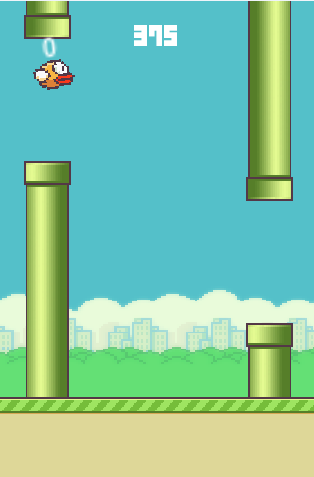
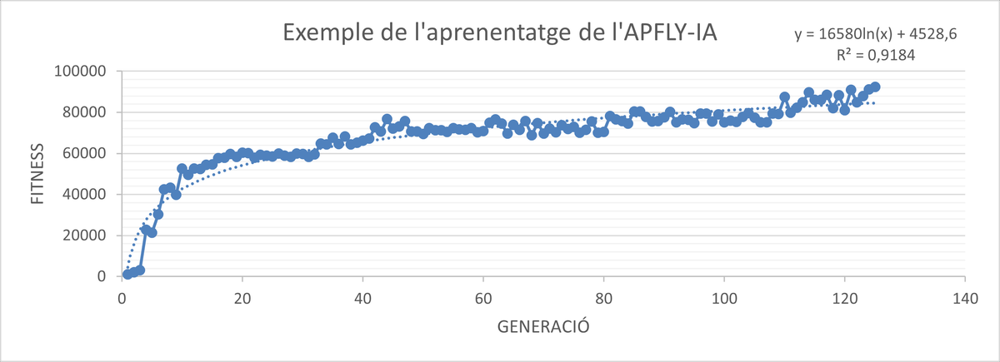
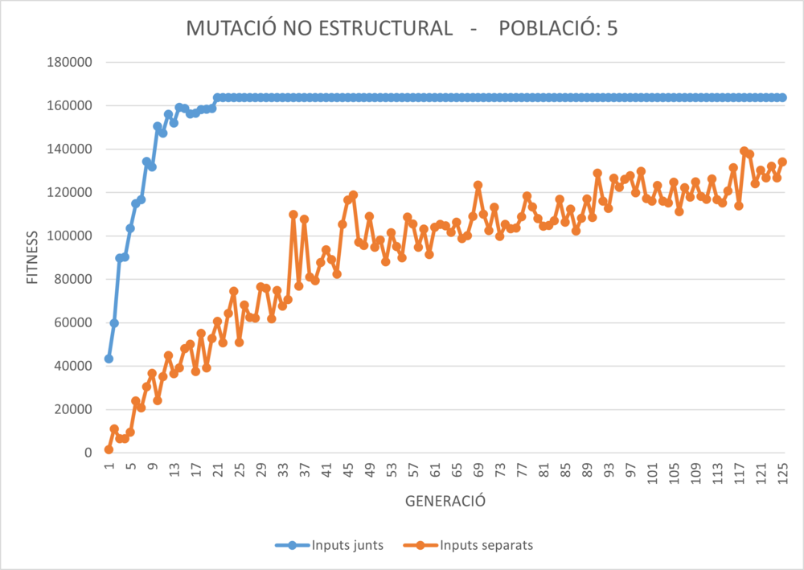
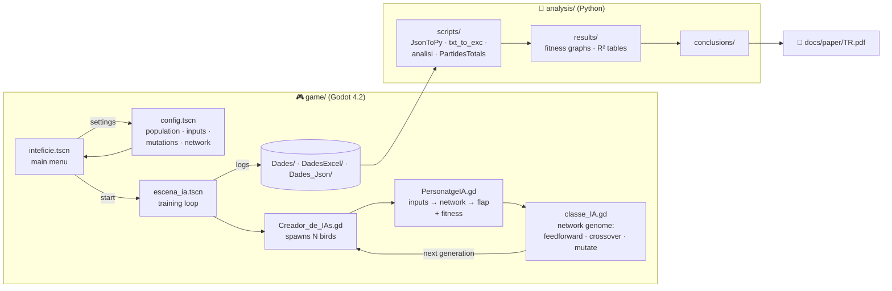
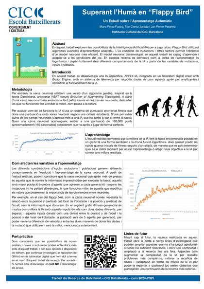

# Beating the Human at Flappy Bird 🐦

**An AI that teaches itself to play Flappy Bird through neuroevolution, and a study of what makes it learn faster.**

🌐 **English** · [Español](README.es.md) · [Català](README.ca.md)


<p align="center">
  
  &nbsp;&nbsp;
  
</p>

High-school research project (*Treball de Recerca de Batxillerat*, Institució Cultural del CIC, Barcelona, 2024–2025), by
**[Marc Pérez Fusco](https://github.com/mapefu)**, **[Jan Ferrer Paramio](https://github.com/FerrerJan)** and **[Teo Clerici Jurado](https://github.com/teo-clerk)**.

We built our own Flappy Bird in **Godot Engine** as a "digital lab". Inside it lives **APFLY-IA** (*Autonomous Player Fast Learning Yeld*), a NEAT-style neural network written from scratch in GDScript. The game logs every generation to disk, and Python scripts turn those logs into graphs. In total we analysed **3,798 training runs and more than 450,000 generations**.

📄 **[Read the paper (PDF, Catalan)](docs/paper/TR.pdf)** · 🖼️ **[Poster](docs/poster/Poster.pdf)** · 📊 **[Slides](docs/slides/Presentation.pptx)** · 🕸️ **[Interactive project map](docs/architecture/)**

---

## Key findings

| Question | Answer |
|---|---|
| What does learning look like? | **Logarithmic**: big gains in the first generations, then a plateau. Mean R² of the log fit is **0.73**, and individual runs reach up to **0.97**. |
| Which inputs work best? | Only the **bird's Y position (PYO)** and the **gap's Y position (PYF)**. Giving them as a single relative value learns even faster. Extra inputs (gap X, bird velocity) slow learning down. |
| Which mutation works best? | **Non-structural mutation** (changing connection weights). Structural mutations give an early boost but then stall, and crossover adds no clear gain. |
| How big should the population be? | **As big as your machine allows.** 100 was the largest we tested and the fastest to learn. |
| How long does it take? | With the right setup, a **perfect player appears from generation ~8**. |

<p align="center">
  
</p>

## How APFLY-IA works

1. Each **agent** is a small neural network. Its inputs are chosen from PYO, PYF, PXF and VYO, and it has one output. A sigmoid squashes the output to the range 0–1, and **if it is above 0.7 the bird flaps**.
2. A whole **population** of agents plays at the same time. Each agent earns **fitness**: +1000 per pipe passed, a bonus for flying close to the centre of the gap, +1 per second alive, and −100 for hitting the ground.
3. When every bird has died, or a run reaches 150 pipes (about 160,000 fitness), the best agents are kept. The next **generation** is bred from them by copying, crossover and mutation (weight changes, or adding/removing neurons and connections).
4. Every generation is logged to `game/Dades*/`. The Python scripts in `analysis/` aggregate those logs into the graphs and R² tables used in the paper.



> The map above was built with [graphify](https://github.com/safishamsi/graphify), which turned the GDScript code, the analysis scripts and the paper into a knowledge graph. To explore it, open the **[interactive version](https://raw.githack.com/FerrerJan/Treball-de-Recerca-IA/main/docs/architecture/graph.html)** or read the **[report](docs/architecture/GRAPH_REPORT.md)**.

## Repository layout

| Folder | What's inside | Start here |
|---|---|---|
| [`game/`](game/) | The Godot 4.2 project: the game, the AI and the in-game settings menus | [`Scripts/classe_IA.gd`](game/Scripts/classe_IA.gd) (the neural network), [`Scripts/PersonatgeIA.gd`](game/Scripts/PersonatgeIA.gd) (the bird agent), [`Scripts/escena_ia.gd`](game/Scripts/escena_ia.gd) (the training loop) |
| [`game/Dades*/`](game/Dades_Json/) | Raw training logs written by the game (txt + JSON) | `Dades_Json/no monedes/` |
| [`analysis/`](analysis/) | Python scripts, generated graphs (PDF), R² spreadsheets and written conclusions | [`analysis/conclusions/`](analysis/conclusions/) |
| [`docs/`](docs/) | Final deliverables: paper, poster, slides, figures and the project map | [`docs/paper/TR.pdf`](docs/paper/TR.pdf) |
| [`assets/`](assets/) | Original Flappy Bird sprites | |
| [`archive/`](archive/) | Drafts, per-person slides, preliminary research and older data, kept for history | |

Code identifiers and folder names inside `game/` are in **Catalan**. A few you will see often: *xarxa neuronal* = neural network, *població* = population, *mutacions* = mutations, *dades* = data, *personatge* = character, *moneda* = coin.

## Run it yourself

**The game and the AI**

1. Install [Godot 4.2+](https://godotengine.org/download) (standard build, no .NET needed).
2. In the Project Manager, choose **Import** and select [`game/project.godot`](game/project.godot).
3. Press **Play (F5)**. In the main menu, open the settings to choose the population, inputs and mutations, then start training.
   - In-game keys: `Esc` returns to the menu, `R` forces the end of a round, and `A` randomises the networks.
   - To play yourself instead of the AI, open `Escenes/inici.tscn` and press **F6**.

**The analysis**

```bash
pip install openpyxl
python analysis/scripts/PartidesTotals.py   # total games logged (3798)
python analysis/scripts/analisi.py          # interactive R² stats by population / inputs / mutations
python analysis/scripts/JsonToPy.py         # game/Dades_Json/*.json → analysis/data/*.txt
python analysis/scripts/txt_to_exc.py       # analysis/data/*.txt → averaged fitness curves in IA2.xlsx
```

## Read more

<a href="docs/poster/Poster.pdf"></a>

- 📄 **[Full paper](docs/paper/TR.pdf)** (14 pages, Catalan): method, R² table, input/mutation/population analysis, future work and SDG 8.
- 🖼️ **[Poster](docs/poster/Poster.pdf)**: the one-page summary, whose QR code links here.
- 📊 **[Presentation](docs/slides/Presentation.pptx)**: the slides used for the oral defence.
- 🕸️ **[Project map](docs/architecture/)**: an interactive knowledge graph of the code and the paper.

**Future directions** that came out of the work: moving to a non-linear network for harder games, collecting runs from many machines through the JSON logs, and packaging APFLY-IA as a reusable Godot module.

<br clear="right">

---

<sub>Made by three high-school students who wanted to see whether a computer could out-play us at Flappy Bird. It can, by generation 8.</sub>
